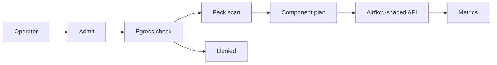
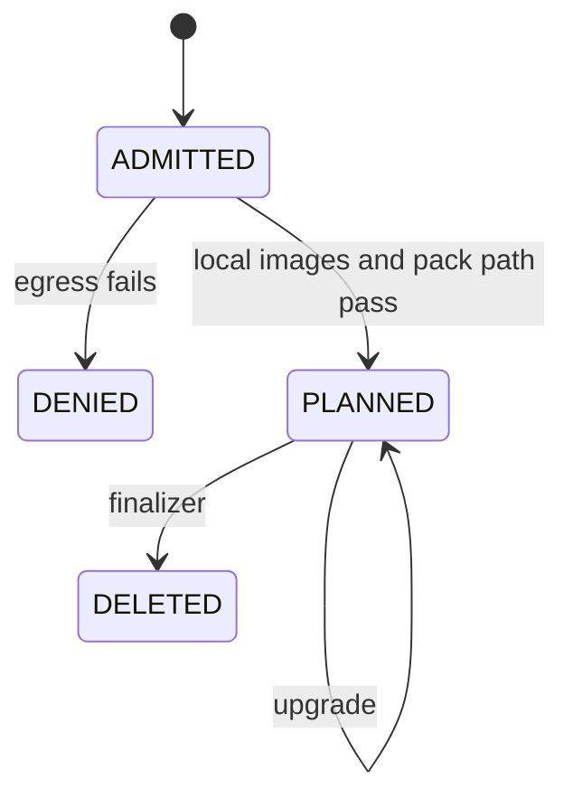

# AstroPlane — Reference implementation

Self-contained Airflow control-plane reference with a reference controller, component provisioning, an Airflow-compatible API, zero-egress installation checks, offline supply-chain packaging, and operational metrics.

Deployment decision: **NO-GO**. The reconciler plans objects in this process. It does not apply them. SchedulerJob, TriggererJob, DagProcessorJob, Postgres, kubelet, and the Kubernetes API server were not started. `components_running` stays 0.

OrchestraScale schedules DAG runs in-process with the Airflow library. AstroPlane provisions the control plane and does not execute DAG runs. This repository does not repeat OrchestraScale's scheduler measurements.

## What this process does

An operator installs an `AirflowCluster` document. The admit step checks egress, the pack path, and the compatibility version. The pack scanner reads committed DAG files as text and does not import them. An admitted cluster stores six Deployment-shaped objects with phase Pending, reason `kubelet not-run`, and `imagePullPolicy` Never. A second install replaces that list. A public image denies the install and stores no objects.

`GET /api/v1/health` reports metadatabase, scheduler, triggerer, and dag_processor as `unhealthy`, with null heartbeats. `GET /api/v1/version` returns `2.11.0` and `git_version` null. That version is the pinned compatibility target, not `airflow.__version__`. `GET /healthz` reports `airflow_distribution` `not-installed`. `POST /api/v1/dags/{dag_id}/dagRuns` returns 503 because the scheduler process is not-run.

## Architecture





Ready stays false. Planned is the admitted phase. Denied stores no deployments. The one-pager is [docs/one-pager.md](docs/one-pager.md).

## What the controller and API tests cover

The Go module in `operator/` is a reference controller. It uses the standard library and saves `AirflowCluster` state in a local JSON journal. `go test -race ./...` provisions a cluster, writes six Pending Deployments, upgrades the local image tag to release `r2`, and runs the finalizer `astroplane.example/finalizer`. A second process opens the same journal and finishes a deletion that the first process only marked. `TestTwoTrimpathBuildsMatch` builds `astroplane-controller` twice with `-trimpath` and requires the same sha256. CI runs that package with `GOPROXY=off`.

The Python API keeps the Airflow-shaped routes and adds SQLite state, `POST /v1/clusters/{id}/upgrade`, and `DELETE /v1/clusters/{id}`. `tests/test_lifecycle.py` reopens the SQLite file in a new store and finishes a deletion that was saved as `Deleting`.

Installation, configuration, and recovery procedures are in [docs/installation.md](docs/installation.md), [docs/configuration.md](docs/configuration.md), and [docs/recovery.md](docs/recovery.md).

The CRD at `infrastructure/crds/airflowcluster.yaml` is still an unapplied sketch. The egress check is still an in-process spec check. `zero-egress-network-namespace` stays not-run. Health stays unhealthy, and creating a DAG run still returns 503 because the scheduler process is not-run.

## Measured install latency

The sample is 40 in-process installs of `syn-cluster-01` on this workstation. One denied install of `syn-cluster-egress` is outside the percentile sample. The percentile is nearest-rank. Evidence class MEASURED. Cost: no price applied.

Measured install latency on this workstation over 40 planned installs: P50 5.8009 ms, P95 12.9726 ms. The separate denied install took 13.0978 ms and is not part of that percentile.

Machine: Windows-11-10.0.26200-SP0. Processor: Intel64 Family 6 Model 140 Stepping 1, GenuineIntel. cpu_count 8. Python 3.12.10.

After those 40 installs the cluster phase is Planned, 6 deployments are Pending, `components_running` is 0, and the accepted DAG is `SYN-DAG-ETL`. The denied install that follows stores 0 deployments and reason `image-registry:airflow`. The process gauge `components_desired` stays 6. Images were not pulled. The wheelhouse is not vendored.

Methodology: [docs/benchmark-methodology.md](docs/benchmark-methodology.md). Report: [benchmarks/results/benchmark_report.md](benchmarks/results/benchmark_report.md).

## Gates

| Gate | State |
| --- | --- |
| kube-apiserver | not-run |
| kind-cluster | not-run |
| helm | not-run |
| airflow-scheduler-process | not-run |
| image-pull | not-run |
| postgres | not-run |
| zero-egress-network-namespace | not-run |
| wheelhouse-vendoring | not-run |

A passing local test run does not change this table.

## API

Fixture tokens authorize nothing outside this process. `dev-operator-a` and `dev-viewer-a` are tenant-a. `dev-operator-b` is tenant-b. Operators install. Viewers read. A missing bearer token is 401. A viewer install is 403. Another tenant's cluster is 404.

Airflow-shaped reads require `cluster_id` because one process can plan more than one cluster. `is_active` is false. `last_parsed_time` is the text-scan time. `file_token` is omitted. `total_entries` is the count before pagination.

`GET /metrics` renders `astroplane_reconcile_total`, `astroplane_egress_denied_total`, `astroplane_components_desired`, `astroplane_components_running`, `astroplane_dags_accepted`, and `astroplane_import_errors`. The scrape is process-wide. Cluster and DAG reads are tenant-scoped.

## Offline pack

| File | Tenant | Result |
| --- | --- | --- |
| datasets/offline/dags/syn_dag_etl.py | tenant-a | accepted as SYN-DAG-ETL |
| datasets/offline/dags/syn_dag_leak.py | tenant-a | import error, external URL |
| datasets/offline/dags/syn_dag_other.py | tenant-b | invisible to tenant-a |

`datasets/offline/images.lock.json` is evidence class SPEC. Digests are `not-pulled`. References:

- `registry.local/astroplane/airflow:2.11.0`
- `registry.local/astroplane/postgres:16`
- `registry.local/astroplane/statsd:local`

## Sketches

These files were not applied, built, imported, or started.

- `infrastructure/crds/airflowcluster.yaml`
- `infrastructure/grafana/dashboard.json`
- `infrastructure/terraform/main.tf` (account fixture `000000000000`, no resources)
- `Dockerfile` (`python:3.12-slim` is a public developer base; the custom resource still refuses public registries)
- `docker-compose.yml` (profiles only, `registry.local` names, fixture password `local-demo-only`)

## Layout

```text
src/astroplane/          reconciler, planner, egress, pack, API
datasets/clusters/       AirflowCluster documents
datasets/offline/        DAG pack and image lock
benchmarks/              nearest-rank helper and the measured report
infrastructure/          unapplied CRD, dashboard, and Terraform sketch
docs/                    architecture, methodology, threat model
```

Threat model: [docs/threat-model.md](docs/threat-model.md).
