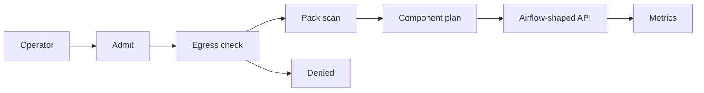
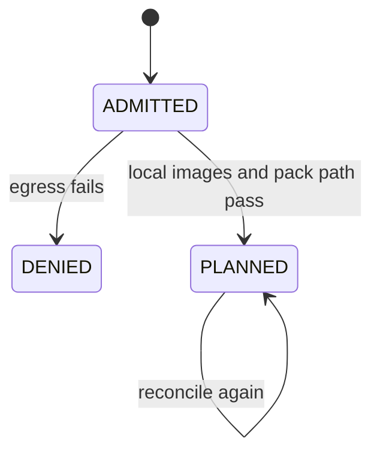

# Architecture

AstroPlane is an in-process control plane for an Airflow installation that has not been started. The reconciler, the pack scanner, the egress check, and the Airflow-shaped API run in this Python process. A Kubernetes API server, kubelet, Helm, kind, the Airflow scheduler, and a metadata database are adapter slots. Each one is `not-run`.

OrchestraScale schedules DAG runs in-process with the Airflow library. AstroPlane provisions the control plane and does not execute DAG runs.

`Ready` stays false. The phase names above are the ones the reconciler writes. A planned cluster is not a running cluster.

## Admit

`admit_spec` refuses the install when any of these hold:

- `egress.mode` is not `deny-all`
- an allow entry contains `://` or does not end with `.svc`
- an image does not start with `registry.local/astroplane/`
- `offlineDagPack` is not `datasets/offline/dags`
- `airflowVersion` is not the compatibility target `2.11.0`

A denied install stores no Deployment objects. The egress reasons are kept on the cluster record.

## Plan

An admitted install stores six Deployment-shaped objects: scheduler, webserver, dag-processor, triggerer, metadata, and statsd. Each object has `status.applied` false, `status.phase` Pending, `status.reason` `kubelet not-run`, `readyReplicas` 0, and `image_digest` `not-pulled`. `imagePullPolicy` is `Never`. A second install replaces that list. It does not append a copy.

The cluster conditions are Egress, PackScanned, and Ready. Ready is false with reason `kube-apiserver not-run` when the install was admitted, and `egress-denied` when it was not.

## Pack

DAG files under `datasets/offline/dags` are text. The scanner reads headers and looks for `http://` or `https://`. It does not import the files and it does not execute them. The tenant header is applied first, so another tenant's file is omitted rather than reported as an import error. A URL in this tenant's file becomes an import error whose `stack_trace` is the scanner message.

`datasets/offline/images.lock.json` is evidence class SPEC. Every digest is `not-pulled`. The manifest hashes the committed offline files. The wheelhouse is `not-vendored`. `apache-airflow` is not a project dependency.

## API

`GET /api/v1/health` returns HealthInfo for Airflow 2.11, including metadatabase, scheduler, triggerer, and dag_processor. Every status is `unhealthy` and every heartbeat is null. `GET /api/v1/version` returns `version` `2.11.0` and `git_version` null. That version string is the pinned compatibility target. `GET /healthz` says `airflow_distribution` is `not-installed`.

`GET /api/v1/dags` and `GET /api/v1/importErrors` require a `cluster_id` query parameter. Airflow's OpenAPI does not have that parameter. This process can hold more than one cluster, so the parameter selects one. `is_active` is false because Airflow defines it as whether a scheduler currently sees the DAG. `last_parsed_time` is the time this process scanned the text. It is not a DagProcessorJob heartbeat. `file_token` is omitted.

`POST /api/v1/dags/{dag_id}/dagRuns` returns 503 with detail `scheduler process is not-run`. The body is not stored.

## Auth

Fixture tokens authorize nothing outside this process.

| Token | Tenant | Role |
| --- | --- | --- |
| dev-operator-a | tenant-a | operator |
| dev-viewer-a | tenant-a | viewer |
| dev-operator-b | tenant-b | operator |

A missing or unknown bearer token is 401. A viewer install is 403. A cluster or audit from another tenant is 404. Metrics are process-wide on purpose in this stand-in. They are not a tenant-scoped scrape.

## Sketches that were not executed

The CRD, the Grafana dashboard, the Terraform file, the Dockerfile, and Compose are sketches. Grafana was not imported. Terraform declares no resources and names account `000000000000`. Compose puts every service behind a profile and uses `registry.local` image names. The public `python:3.12-slim` base in the Dockerfile is a developer sketch. The AirflowCluster path still refuses public registries.
