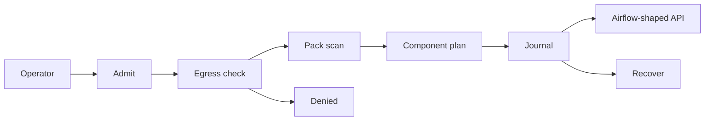
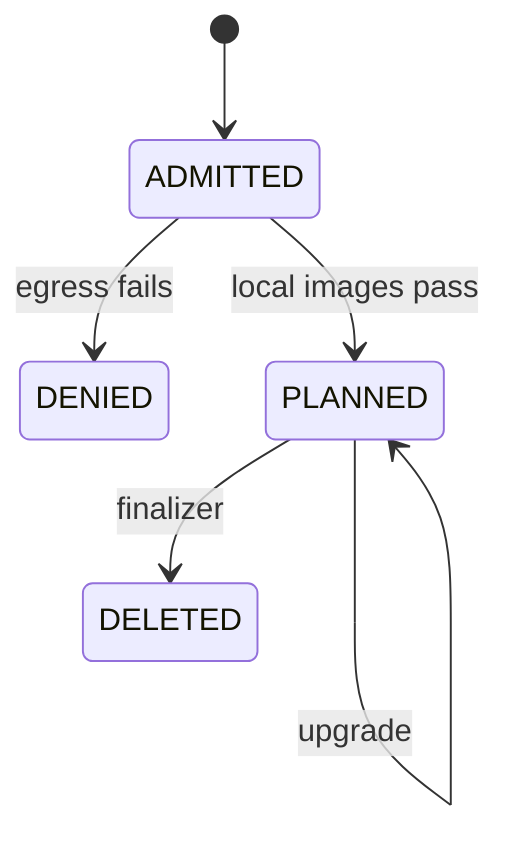

# AstroPlane — Reference implementation

AstroPlane is a reference controller and a local control plane for an Airflow installation that has not been started. The Go package uses the standard library and reconciles `AirflowCluster` objects in a JSON journal. The Python API serves the Airflow 2.11 shapes and stores its own SQLite journal. The CRD file has not been applied. Neither process posts objects to a Kubernetes API server.

| Piece | Where it runs | What a test proves |
| --- | --- | --- |
| CRD | `infrastructure/crds/airflowcluster.yaml` | The file is the schema sketch. It has not been applied. |
| Go reconcile | `operator/internal/controller` | Provision writes six Pending Deployments and one finalizer. A public image stores none. |
| Upgrade | Go controller and `POST /v1/clusters/{id}/upgrade` | Release `r2` rewrites the local Airflow image tag. `applied` stays false. |
| Delete | Finalizer `astroplane.example/finalizer` | Deployments are cleared and the object leaves the journal. |
| Restart | A second process opens the same journal | A deletion timestamp saved by the first process is finished by the next `Open`. |
| Offline check | Egress policy and a stdlib-only Go module | Images must start with `registry.local/astroplane/`. `GOPROXY=off` is how CI runs `go test`. |
| Airflow API | Python FastAPI | Health stays unhealthy. Creating a DAG run returns 503. |

Deployment decision: NO-GO. kube-apiserver, kind, Helm, the Airflow scheduler, image pull, Postgres, a zero-egress network namespace, and wheelhouse vendoring are not-run.
